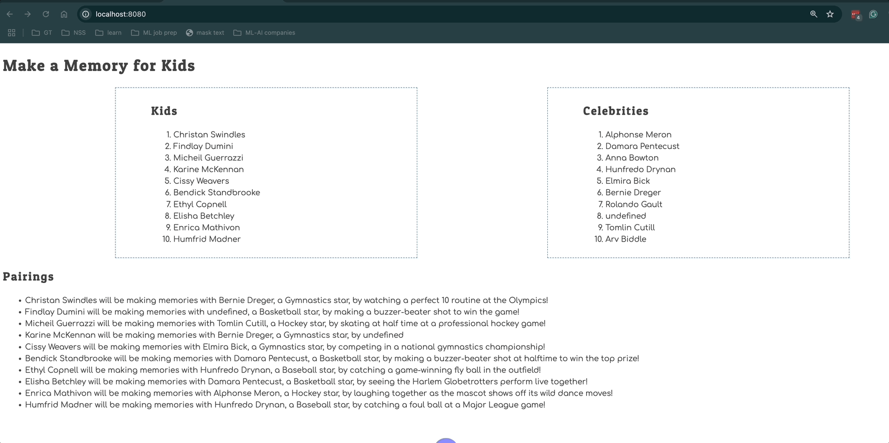

# Events and Debugging Assessment

Time to assess how well you have learned to use the debugging tools in Chrome Dev Tools, and writing click event listeners. This application is to show kids with illnesses and the memories the would like to make. Celebrities sign up to help kids make memories.

> 🧨 Make sure you answer the vocabulary and understanding questions at the end of this document before notifying your coaches that you are done with the project

## Event Listeners to Create

1. When the kid name is clicked, it should display their wish.
1. When the celebrity name is clicked, it should display their sport.
1. The pairings list should should contain the pairing in the following format.
   ```html
   {child name} will be making memories with {celebrity name}, a {celebrity
   sport} star, by {child wish}
   ```

Below is an animation showing how the application should look when complete and how the event listeners should work.



## Setup

Your instruction team will provide a link for you to create your assessment repository. Once your repo is created, clone it to your machine.

1. Make sure you are in your `workspace` directory.
1. `git clone {github repo SSH string}`.
1. `cd` into the directory it creates.
1. `code .` to open the project code.
1. Use the `serve` command to start the web server.
1. Open the URL provided in Chrome.

Make sure your Developer Tools are open at all times while working on this project. Use the messages provided in the Console to determine what code needs to be fixed or implemented, and use breakpoints in the Sources tab to step through your code as you debug.

## Vocabulary and Understanding

Before you click the "Complete Assessment" button on the Learning Platform, add your answers below each question and make a commit.

1. When a child is clicked on in the browser, which module contains the code that will execute on that event happening? Can you explain the algorithm of that logic?
   > Your answer here When the kids list is built, each list has the kid’s wish assigned to wish attribute. When a child is clicked, the target gives the listener the list <li> that was clicked. The loop checks that it's for a “child,” so it only runs for kids. Then it reads wish list from that <li> and shows it in an alert.
2. In the **Pairings** module, why must the `findCelebrityMatch()` function be invoked inside the `for..of` loop that iterates the kids array?
   So it's invoked to pair each kid to the correct celebrity id

3. In the **CelebrityList** module, can you describe how the name of the sport that the celebrity plays can be displayed in the window alert text?
   > Your answer here: When the celebrity list is built each list has the celebrity's sport assigned to sport attribute. When celebrity is clicked the target gives the listener the <li> that was clicked then it pulls from it the sport list it is assigned to
4. Can you describe, in detail, the algorithm that is in the `main` module?
   > Your answer here: Imports the Kids, Celebrities, and Pairings functions from their files. Finds the container with the DOM. brings each function, and each returns HTML from its list and Puts all that HTML into theinnerHTML
